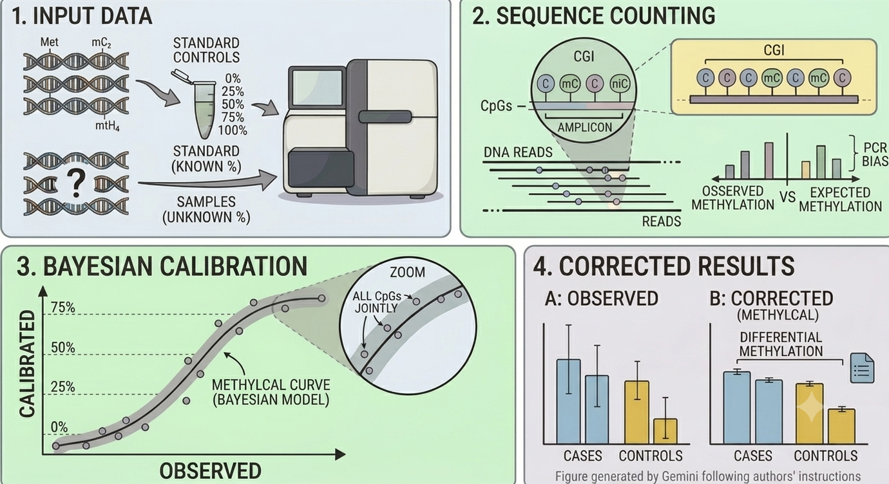

# MethylCal

**MethylCal** is an R package for the calibration of methylation levels
using a Bayesian calibration tool based on INLA
([Rue et al., 2009](https://doi.org/10.1111/j.1467-9868.2008.00700.x)).
The package allows visualisation of the calibration curve derived from
standard controls with known methylation percentages for a selected assay,
and correction of methylation levels in case and control samples. If case
samples are provided, MethylCal performs a differential methylation test to
detect hyper- and hypo-methylated samples. In addition to MethylCal, the
package includes the calibration and correction provided by two alternative
methods ([Warnecke et al., 1997](https://doi.org/10.1093/nar/25.21.4422);
[Moskalev et al., 2011](https://doi.org/10.1093/nar/gkr213)).

See [Ochoa et al. (2019)](https://doi.org/10.1093/nar/gkz325) for full
methodological details.

## What's new in version 0.2.0

- **More reliable.** A model that fails to fit is skipped instead of stopping
  the whole analysis. Tested with the latest **R-INLA** (version 26.08.07).
- **Faster.** Models are now fitted once per target instead of once per CpG
  and calibration level. In theory this reduces the number of model fits for a
  target with 70 CpGs and 3 calibration levels from 210 to 1. The repeated
  calibration-curve inversion also runs in compiled C++ code (via **Rcpp**).
- **Works with your old code.** Scripts written for version 0.1.0 still run.
  Only one argument was renamed: `writing` in `TableFormatting()` is now
  `write_out` (the old name still works).

## Installation

1.  Install [**R-INLA**](https://www.r-inla.org/), on which **MethylCal** depends. It is not on **CRAN** and must be installed manually. Invoke R and then type

    ```r
    install.packages(
        "INLA",
        repos = c(getOption("repos"),
                  INLA = "https://inla.r-inla-download.org/R/stable"),
        dep   = TRUE
    )
    ```

    (on macOS with a Homebrew R see the installation notes below)

2.  Install the [**pak**](https://pak.r-lib.org/) package from **CRAN**. Invoke R and then type

    ```r
    install.packages("pak")
    ```

3.  Install the **MethylCal** package from GitHub by typing

    ```r
    pak::pak("lb664/MethylCal")
    ```

4.  Finally, load the **MethylCal** package

    ```r
    library("MethylCal")
    ```

## Installation notes

**C++ compiler.** **MethylCal** contains compiled C++ code (via **Rcpp**), so a compiler is needed when it is installed from GitHub: [Rtools](https://cran.r-project.org/bin/windows/Rtools/) on Windows, the Xcode command line tools on macOS (`xcode-select --install` in a terminal) and `g++` on Linux.

**macOS and R-INLA.** If R was built from source (e.g. installed with Homebrew),
`install.packages()` cannot use `type = "binary"` and installs the INLA *source*
package, which does not contain the INLA executable (`inla()` then fails with
*"INLA installation error; no such file"*). In this case download the binary
package for your R version and architecture from
<https://inla.r-inla-download.org/R/stable/bin/macosx/> (e.g.
`big-sur-arm64/contrib/4.6/INLA_26.08.07.tgz`) and install it with
`R CMD INSTALL INLA_26.08.07.tgz`.

## Example

The code below replicates **Figure 3** C&D in
[Ochoa et al. (2019)](https://doi.org/10.1093/nar/gkz325):

```r
data(BWS_data)
AMP      <- c(0, 25, 50, 75, 100)
data     <- Formatting(BWS_data, AMP = AMP, n_Control = 15, n_Case = 18)
corr_data <- MethylCalCorrection(data, Target = "KCNQ1OT1",
                                 n_Control = 15, n_Case = 18,
                                 printing = FALSE)
```

The corrected methylation levels can be exported in the same format as
the input data using:

```r
output_data <- TableFormatting(corr_data, n_Control = 15, n_Case = 18)
```

## Vignette

A full vignette with all code needed to reproduce the figures in
[Ochoa et al. (2019)](https://doi.org/10.1093/nar/gkz325) is installed with the
package. Open it with

```r
vignette("MethylCal", package = "MethylCal")
```

## References

- Ochoa E, Zuber V, Fernandez-Jimenez N, Bilbao JR, Clark GR, Maher ER,
  Bottolo L. MethylCal: Bayesian calibration of methylation levels.
  *NAR Genomics and Bioinformatics*. 2019.
  <https://doi.org/10.1093/nar/gkz325>
- Rue H, Martino S, Chopin N. Approximate Bayesian inference for latent
  Gaussian models by using integrated nested Laplace approximations.
  *J R Stat Soc B*. 2009; 71(2):319–392.
  <https://doi.org/10.1111/j.1467-9868.2008.00700.x>
- Moskalev EA et al. Correction of PCR-bias in quantitative DNA methylation
  studies by means of cubic polynomial regression.
  *Nucleic Acids Res*. 2011; 39(11):e77.
  <https://doi.org/10.1093/nar/gkr213>
- Warnecke PM et al. Detection and measurement of PCR bias in quantitative
  methylation analysis of bisulphite-treated DNA.
  *Nucleic Acids Res*. 1997; 25(21):4422–4426.
  <https://doi.org/10.1093/nar/25.21.4422>

## News/changelog

For a version history/changelog, please see [Changelog](https://github.com/lb664/MethylCal/blob/main/CHANGELOG.md)

## Issues

To report an issue, please use the **MethylCal** issue tracker at [BugReports](https://github.com/lb664/MethylCal/issues)

## License and authors

This software uses the GPL v2 license, see [License](https://github.com/lb664/MethylCal/blob/main/LICENSE). Authors and copyright are provided in [Description](https://github.com/lb664/MethylCal/blob/main/DESCRIPTION)
